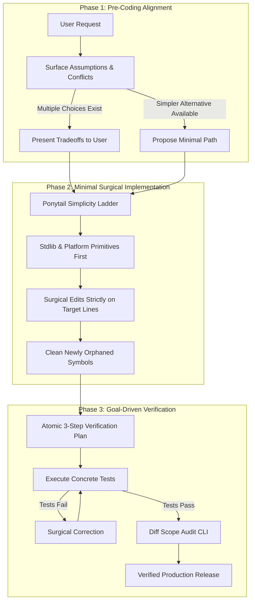

<div align="center">

# ⚡ expected-2-unexpected

### Behavioral Guidelines to Eliminate Common LLM Coding Mistakes
**Surface Assumptions • Simplicity First • Surgical Diffs • Verifiable Goals**

[](LICENSE)
[](https://bun.sh)
[](https://nodejs.org)
[](https://skills.sh)
[](https://claude.ai)
[](SKILL.md)
[](SKILL.md)

<p align="center">
  <a href="#-executive-overview">Overview</a> •
  <a href="#-quickstart">Quickstart</a> •
  <a href="#-architecture">Architecture</a> •
  <a href="#-the-four-pillars">Four Pillars</a> •
  <a href="#-the-ponytail-ladder">Ponytail Ladder</a> •
  <a href="#-cli-reference">CLI Reference</a> •
  <a href="#-troubleshooting">FAQ</a>
</p>

</div>

---

## 📌 Executive Overview

`expected-2-unexpected` is a universal agentic skill and developer CLI designed to prevent the four most common LLM coding blunders: silent assumptions, premature abstraction, diff sprawl, and unverified completion claims.

By enforcing strict pre-coding clarity, the Ponytail simplicity ladder, surgical diff containment, and automated red-green verification loops, this skill ensures that every changed line traces directly to user requirements with zero accidental regressions.

---

## 🚀 Quickstart

### 1. Zero-Install CLI Inspection

Analyze staged git changes for scope sprawl, adjacent edits, and unrequested abstractions:

```bash
# Using npx (Node.js)
npx expected-2-unexpected audit --staged

# Using Bun (Instant)
bunx expected-2-unexpected audit --staged
```

### 2. Universal Agent Installation (One Command)

Install the skill across Claude Code, Google Antigravity / Gemini CLI, Codex, OpenCode, and the Universal Agent Kernel:

```bash
curl -fsSL https://raw.githubusercontent.com/imMamdouhaboammar/expected-2-unexpected/main/install.sh | bash
```

### 3. Skills.sh Registry Installation

```bash
npx skills add imMamdouhaboammar/expected-2-unexpected
```

---

## 📊 Comparative Feature Matrix

| Common LLM Deficit | Without This Skill | With expected-2-unexpected |
|---|---|---|
| **Ambiguous Requirements** | Model silently guesses an interpretation | Surfaces assumptions and presents multiple tradeoffs before coding |
| **Architectural Scope** | Invents generic factories, single-use interfaces, and unused configs | Enforces the Ponytail Simplicity Ladder (YAGNI, stdlib, minimum code) |
| **Git Diff Cleanliness** | Reformats adjacent functions, alters comments, and breaks git blame | Surgical containment: touches only target lines and removes new orphans |
| **Completion Claims** | Claims "it works" without executing code | Enforces red-green falsification with concrete test commands |

---

## 🏗 Architecture

The following diagram illustrates the agentic execution flow enforced by `expected-2-unexpected`:



---

## 🏛 The Four Non-Negotiable Pillars

### 1. Think Before Coding
- **Surface assumptions explicitly.** If uncertain, ask before writing code.
- **Present multiple interpretations.** Never choose silently when ambiguity exists.
- **Push back when warranted.** If a simpler approach exists, say so directly.
- **Stop when requirements conflict.** Name what is confusing.

### 2. Simplicity First
- **Minimum code that solves the problem.** Nothing speculative.
- **Zero unrequested features or abstractions.** No single-use interfaces.
- **Zero premature configurability.** Hardcode constants until multiple callers require distinct values.
- **The Senior Engineer Litmus Test.** If a senior engineer would call the implementation overcomplicated, simplify immediately.

### 3. Surgical Changes
- **Touch only what you must.** Clean up only your own mess.
- **Zero adjacent drift.** Never improve adjacent comments, reformat untouched lines, or rewrite surrounding functions.
- **Orphan management.** Remove imports and variables that your changes made unused. Keep pre-existing dead code untouched unless requested.
- **Traceability invariant.** Every modified line must trace directly to the prompt.

### 4. Goal-Driven Execution
- **Define concrete success criteria.** Loop until verified.
- **Transform vague tasks.** Turn "fix bug" into "write reproduction test, confirm failure, apply fix, confirm pass."
- **Three-step verification plan:**
  ```text
  1. [Reproduction / Baseline] -> verify: [check command]
  2. [Surgical Modification]   -> verify: [check command]
  3. [Regression Audit]        -> verify: [check command]
  ```

---

## 🪜 The Ponytail Simplicity Ladder

Climb this ladder for every implementation decision. Stop at the first rung that holds:

```text
[Rung 1] Does this need to exist at all? (YAGNI)
   ↓
[Rung 2] Does the codebase already have an internal helper?
   ↓
[Rung 3] Does the standard library do it?
   ↓
[Rung 4] Does the native platform / runtime cover it?
   ↓
[Rung 5] Does an already-installed dependency solve it?
   ↓
[Rung 6] Can it be a clean, readable one-liner?
   ↓
[Rung 7] Only then: write the minimum custom logic.
```

---

## 💻 CLI Reference

The zero-dependency CLI runs out of the box via `npx` or `bunx`:

| Command | Flags | Description |
|---|---|---|
| `audit` | `--staged` | Analyze staged git changes for scope sprawl and cosmetic churn |
| `audit` | `--base <ref>` | Diff against a base branch or commit (e.g. `main` or `HEAD~1`) |
| `audit` | `--file <path>` | Analyze a saved `.diff` file |
| `audit` | `--json` | Output machine-readable JSON report |
| `check` | *(none)* | Run structural and portability self-checks on the skill package |
| `install`| *(none)* | Link skill into Claude Code, Antigravity, and Codex local config |
| `guidelines` | *(none)* | Print the 4 pillars and the simplicity ladder to stdout |

---

## ❓ Troubleshooting & FAQ

<details>
<summary><b>Why does the diff analyzer flag my factory class?</b></summary>
<p>
The analyzer detects speculative design patterns like <code>*Factory</code> or single-implementation interfaces. If the user explicitly requested a factory pattern, the finding can be disregarded; otherwise, flatten the factory to a direct constructor or concrete function.
</p>
</details>

<details>
<summary><b>How does this differ from general linter tools?</b></summary>
<p>
Traditional linters check syntax and formatting. <code>expected-2-unexpected</code> enforces behavioral discipline: preventing agents from overcomplicating architecture, touching adjacent files, or claiming success without running tests.
</p>
</details>

<details>
<summary><b>Can I use this with Cursor or Windsurf?</b></summary>
<p>
Yes. The skill adheres to the Agent Skills standard and can be added as a project rule or global instruction in Cursor (via <code>.cursorrules</code> or <code>.cursor/rules</code>), Windsurf, Claude Code, and Google Antigravity.
</p>
</details>

---

## 📄 License

Distributed under the [MIT License](LICENSE). Copyright © 2026 Mamdouh Aboammar.
